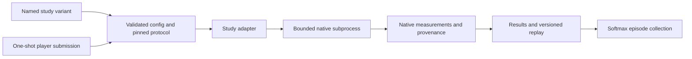

# Sugarscape research variants in Coworld

## Decision

Use one Sugarscape world family with named, versioned study variants.
Keep the current DTL/SugarLang variants and their protocol intact.
Add study adapters that execute the audited paper implementations; a DTL configuration is not a substitute for a different engine.

This is an implementation design, not a claim that the ten research variants are hosted or implemented.
The research lives in [Metta-AI/sugarscape](https://github.com/Metta-AI/sugarscape), with [ten reviewed studies](https://app.graphite.dev/github/pr/Metta-AI/sugarscape/1).
The serving layer belongs in this repository, outside `archived/`.
Do not move the research engines into the DTL submodule or silently change that submodule's upstream.

## Current implementation and platform fit

The current wrapper already ships `solo-wealth`, `solo-ladder`, `duo-ladder`, `duel-4seat`, and `commonwealth`.
`src/coworld/episode.py` invokes `CoworldSugarscape` directly; `config.py` forces the DTL `ruleset` agent class.
Each player submits one SugarLang ruleset, then the world runs without further player I/O.
Consequently, adding paper parameter names to `scenario_pool` cannot reproduce the ten different study methods.

Coworld's `variants[]` select token-free `game_config` objects within one manifest.
The current variant schema has no per-variant game image or resource override.
One game image must therefore contain every backend it dispatches; start backend subprocesses directly, without nested Docker or remote worker credentials.
The manifest's game resource reservation must accommodate every included variant.

Keep `platform-hosted` players for the existing image/WebSocket protocol and the proposed one-shot research submissions.
The game still owns rules, native simulation and scoring. Player containers can use their own inference implementation.
A future file-only collection could choose `game-hosted`, but player runtime is a game-level choice, not a per-variant switch.
The current baseline policy is not automatically a valid research policy; bundle and certify a research baseline explicitly.

## Reference experiments versus playable challenges

Two modes have different purposes:

- **Reference experiment:** fixed native rules, frozen parameters, seed schedule and metric definitions. Run the bundled reference controller; disable ranked league use. If the platform requires a score, use an explicitly noncompetitive constant, with scientific outcomes in separate fields.
- **Research challenge:** a player selects allowed parameters or interventions before simulation. The result can have a variant-specific score, but the player interface and objective are new experimental choices. Label them as adaptations, and retain the reference mode for fidelity checks.

Do not expose arbitrary Python, Java, Haskell, Julia, R, file paths, shell commands, or environment variables through player submissions.
Validate a closed parameter payload before invoking the adapter. The selected variant owns permitted controls and bounds.
A seed supplied for reproduction is recorded in artifacts; ranked observations must not reveal evaluation seeds or hidden targets.
One policy seat is not one simulated agent. Most studies need one controller seat; breeding groups or intervention arms remain native simulation entities.

A paper's calibration, optimizer or fifty-seed experiment is normally an external campaign of episodes.
Do not present a shortened single episode as a completed replication of that campaign.
Full training and parameter-estimation jobs stay in the research harness; their resulting policies or parameter choices can be evaluated in Coworld.

## Variant map

Names below are proposed stable identifiers, not currently registered variants.
Every adapter still needs an in-container equivalence check against the retained research evidence.

| Proposed variant family | Audited implementation | Player-controlled adaptation, if offered | Fidelity boundary |
| --- | --- | --- | --- |
| `mcculloch-2022` | Mesa release or the independently validated study Python model | Maximum metabolism and vision for calibration | Preserve bounded map, Manhattan vision, initialization collisions and inactive grid occupants. |
| `carrella-2021` | Author NetLogo model or study Python reconstruction | Original simulation parameters | Preserve cached utility, trading and mutation. Python randomness is not NetLogo trajectory identity. Estimator fitting remains a campaign. |
| `dogan-2026` | Pinned author Python model bundled in the fork | Original automation/policy menu | Keep the original nonconserving levy in reference mode. Name the corrected-conservation mode separately. Working paper status stays visible. |
| `izquierdo-2009` | Study Python formal-model implementation | Sample ordinary stochastic dynamics; optionally inspect recorded proof paths | Constructive return/regeneration paths are controlled witnesses, not unbiased stationary samples or meaningful competitive policies. |
| `quera-2025` | Pinned Julia Sugarscape and differentiable workflow | Six physical parameters, with the documented dependent-coordinate constraint | Keep native update/gradient conventions. Training is external; an interactive episode does not reproduce the 5,000-epoch estimator experiment. |
| `thaler-2019` | Original Haskell implementations | Original strategy/capability settings | Containers can demonstrate dynamics and counters. Shared hosted CPU timings cannot reproduce historical hardware scaling. |
| `richmond-2023` | Native FLAME GPU/CUDA implementation | Original occupation/resolution settings | Requires compatible GPU/runtime. Preserve author-code defects in reference mode; corrected controls remain separately named. |
| `lima-2024` | Two native NetLogo models, JaCaMo and database routing | Original scenario selection | Exchanges and saved-state behavior are the method. Replacing them with one in-memory world would change it. The desktop-GUI scenario needs separate retained validation. |
| `oremland-2014` | Study NetLogo reconstruction and policy evaluator | Original bounded tax-policy schedule | Name tax-clock, payment and death-rule interpretations. Preserve reconstruction labels and original evaluation horizon. |
| `brearcliffe-2020` | Author NetLogo 6.1.1 model with qualified recorder | Original Rule M/EC/Q/SARSA pairing | Expose released and manuscript learning parameters as separate variants. Preserve local measurement randomness and native internal learning. |

Use subvariants only for scientifically meaningful protocol differences: for example, `brearcliffe-2020-released` and `brearcliffe-2020-paper-table`.
Do not make each seed a new variant, or fold two conflicting parameter interpretations into an undocumented random choice.
References: [study PR index](https://app.graphite.dev/github/pr/Metta-AI/sugarscape/1), [Brearcliffe](https://app.graphite.dev/github/pr/Metta-AI/sugarscape/23), [Dogan](https://app.graphite.dev/github/pr/Metta-AI/sugarscape/11).

## Episode flow

The server keeps authentication, connection handling and live viewer routes.
A synchronous study adapter owns native initialization, accepted controls, execution limits, native outputs and deterministic state sampling.
The adapter must not translate an author's rules into DTL implicitly.
The existing DTL episode remains an explicit backend; do not route old published replays through the new adapters.

Record study ID, protocol version, engine revision, source hashes, parameter interpretation, runtime image digest, resolved seed and actual horizon in replay provenance.
Keep raw native observations separate from visual frames and leaderboard scores.
An observer must not consume the simulation random stream or reorder activation; Brearcliffe already demonstrated that failure mode.

Extend replay encoding with an explicit engine/schema version while retaining readers for published replays.
A common grid view can show resources and agents where those concepts exist; engine-specific panels show tax flows, transfers, calibration or counters.
Do not synthesize agent-level animation from aggregate-only historical CSVs.
Finish replay and diagnostic outputs before writing the results completion marker.
A native crash is a failed game execution, not a low scientific score or a successful truncated episode.

## Packaging and resource boundaries

Start with the CPU Python families: McCulloch, Carrella, Dogan and Izquierdo.
Their audited implementations are already in the research fork and require no desktop GUI or CUDA runtime.
Pin each source commit explicitly: the ten studies currently live on separate PR branches, not a single merged package release.
Build from those immutable sources, with their notices and licenses; never fetch a moving branch at episode startup.
A later reviewed research-package release can replace the per-study source pins.

Add NetLogo families next, using the qualified native version for each adapter.
Keep Julia, Haskell and Lima's multi-process runtime behind separate build milestones.
For Lima, colocating NetLogo, JaCaMo and an episode-local database requires real routing/recovery validation, not just importing their libraries.

Richmond is the resource exception. A single manifest containing it would reserve a GPU-capable game runtime for the whole collection.
Prefer a CPU Sugarscape collection plus a clearly linked `sugarscape-gpu` companion if per-episode GPU allocation is unavailable.
That preserves one scientific family without paying GPU costs for every CPU variant.
An all-in-one GPU image is technically another option, but should follow measured startup, memory and cost qualification.
No platform schema change is required for the CPU collection.

## First implementation slice and acceptance

1. Add a McCulloch reference adapter and one named variant, reusing server transport but its audited study model and measurements.
2. Replay frozen cases through the actual game container. Compare complete states and outputs with the retained study implementation, including random state where supported.
3. Add an explicitly separate parameter-selection challenge and bundled baseline. Define its observation, accepted action, score and evaluation seeds before comparing policies.
4. Run complete local episodes through player containers, verify results/replay, and inspect the replay viewer in a browser.
5. Run Coworld certification with every bundled player seated. Only then upload a built version, preserving the world's existing visibility and ownership.
6. Add the next study adapter only after the same native-equivalence and protocol checks pass. Keep independent per-study evidence even when the UI groups variants together.

For hosted-runtime changes, follow Metta's full local Coworld stack before publishing implementation PRs.
This design does not require Conductor, a new fleet, or starting any research ensemble again.

## Verification and source revisions

Reviewed against Metta `aaa330489a54e39408e840f33d90b32b006533d2`, including:

- [`PLAYER_RUNTIMES.md`](https://github.com/Metta-AI/metta/blob/aaa330489a54e39408e840f33d90b32b006533d2/packages/coworld/src/coworld/docs/PLAYER_RUNTIMES.md)
- [`COWORLD_MANIFEST.md`](https://github.com/Metta-AI/metta/blob/aaa330489a54e39408e840f33d90b32b006533d2/packages/coworld/src/coworld/docs/COWORLD_MANIFEST.md)
- [`types.py`](https://github.com/Metta-AI/metta/blob/aaa330489a54e39408e840f33d90b32b006533d2/packages/coworld/src/coworld/types.py), especially `CoworldVariant` and game runtime/resource fields
- [`GAME.md`](https://github.com/Metta-AI/metta/blob/aaa330489a54e39408e840f33d90b32b006533d2/packages/coworld/src/coworld/docs/roles/GAME.md)

The existing wrapper passed 636 functional tests, with five reported skips, and its one serial performance test.
Its five-variant manifest passed the current versioned author-manifest reader after supplying build-time version/image placeholders.
These checks validate the existing baseline and contract assumptions; they do not certify unimplemented research adapters or a hosted deployment.
